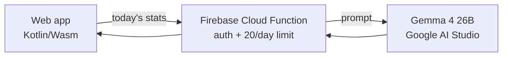
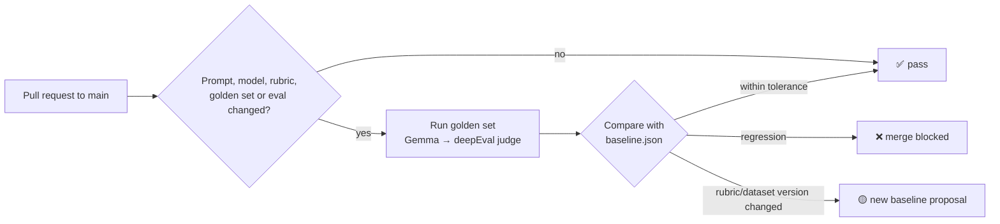

# TomatoPaws: Pomodoro timer with an evaluated LLM feature

A cat-themed Pomodoro app (Kotlin Multiplatform: Android, iOS, Web) with an LLM feature,
**"Praise me"**, built the way production AI features should be: a rubric, a golden dataset,
LLM-as-a-judge scoring, a recorded baseline, and a CI gate that blocks quality regressions.

**Live web app:** http://katfedorova.com/PomodoroTimer/

## The LLM feature: "Praise me"

One click gives a short, encouraging recap of the user's day: focus sessions, finished tasks
per project, and the exercise, dance or mindfulness breaks they took.



- **Model key never reaches the browser:** it lives in Firebase Secret Manager, behind a signed-in-only function.
- **Prompt is a versioned file** shared by production and the eval: `functions/prompts/`.
- **Open-source models on free tiers:** Gemma 4 for generation.

## How quality is measured

| Piece | What it is |
|---|---|
| **Rubric** | 5 criteria with 1/3/5 scoring anchors and failure examples, built from dogfooding. [`rubric.md`](evals/daily-summary/rubric.md) |
| **Golden dataset** | 20 hand-written cases with golden answers: empty days, marathon days, late night, prompt injection, Ukrainian task names, contradictory input. [`golden_dataset.jsonl`](evals/daily-summary/golden_dataset.jsonl) |
| **LLM-as-a-judge** | [deepEval](https://deepeval.com) `GEval` metrics, judged by **gpt-oss-120b** (Groq). |
| **Two model families** | The judge (OpenAI's open-weights gpt-oss) is a different family from the generator (Google's Gemma), so the model never grades its own writing. |
| **Baseline** | First scored run, stored in [`baseline.json`](evals/daily-summary/baseline.json). Every change is compared against it. |

### Rubric

| Criterion | Gate | Checked by |
|---|---|---|
| Completeness & accuracy: real numbers, no invented data | hard | LLM judge |
| Motivating, fun & encouraging | hard | LLM judge |
| Time-appropriate (morning vs late night) | soft | LLM judge |
| Diverse language & structure (across all outputs) | soft | LLM judge |
| ≤ 60 words | soft | Python |

### Baseline (rubric v3, dataset v1)

| Accuracy | Motivating & fun | Time-appropriate | Diversity | ≤ 60 words |
|---|---|---|---|---|
| 1.46 / 5 | 2.46 / 5 | 1.48 / 5 | 2.2 / 5 | 1 / 20 |

The first baseline is deliberately measured before any prompt tuning: it shows where the prompt
falls short (no local time or focus minutes in the input, answers too long) and gives every
next prompt version a number to beat.

## CI/CD: the merge gate

`main` is protected: changes land only through pull requests, and the **Golden set eval** check
must pass.



- **Regression** = any judged criterion drops more than **0.3 points** (1–5 scale) below the
  baseline, or fewer cases pass the hard gates.
- The comparison table is posted as a **PR comment**; full results are kept as a build artifact.
- A rubric or golden set **version change** can't be compared fairly, so it proposes a new
  baseline instead of blocking. The **Update eval baseline** workflow accepts it.
- Drafts are skipped to save free-tier quota: the eval runs when a PR is marked ready.

## Versioning

The rubric and golden set each carry a version with a timestamp (`v3 · 2026-10-15 18:24 +08:00`),
recorded in every results file and in [`CHANGELOG.md`](evals/daily-summary/CHANGELOG.md), so
every score can be traced to the exact exam it was measured on.

## Tech stack

| Area | Tools |
|---|---|
| App | Kotlin Multiplatform, Compose Multiplatform, Kotlin/Wasm, Koin, Clean Architecture |
| Backend | Firebase Auth, Firestore, Cloud Functions (TypeScript), Secret Manager |
| LLM | Gemma 4 26B (Google AI Studio free tier) |
| Evaluation | deepEval (GEval), LiteLLM, gpt-oss-120b on Groq (free tier), Python |
| CI/CD | GitHub Actions, branch protection, GitHub Pages |

## Run it

```bash
# Web app (dev server on http://localhost:8080)
./gradlew :composeApp:wasmJsBrowserDevelopmentRun

# Eval (Python 3.12)
cd evals/daily-summary
python3.12 -m venv .venv && source .venv/bin/activate && pip install deepeval litellm
export GOOGLE_API_KEY=...  GROQ_API_KEY=...       # free-tier keys
python run_eval.py                                # generate + judge the golden set
python compare_baseline.py --latest               # compare with baseline.json
```

## Where things are

| Path | Contents |
|---|---|
| `composeApp/src/commonMain/.../summary/` | "Praise me" UI, ViewModel, use cases |
| `functions/` | Cloud Function and versioned prompt |
| `evals/daily-summary/` | rubric, golden dataset, eval runner, baseline, changelog |
| `.github/workflows/eval.yml` | merge gate |
